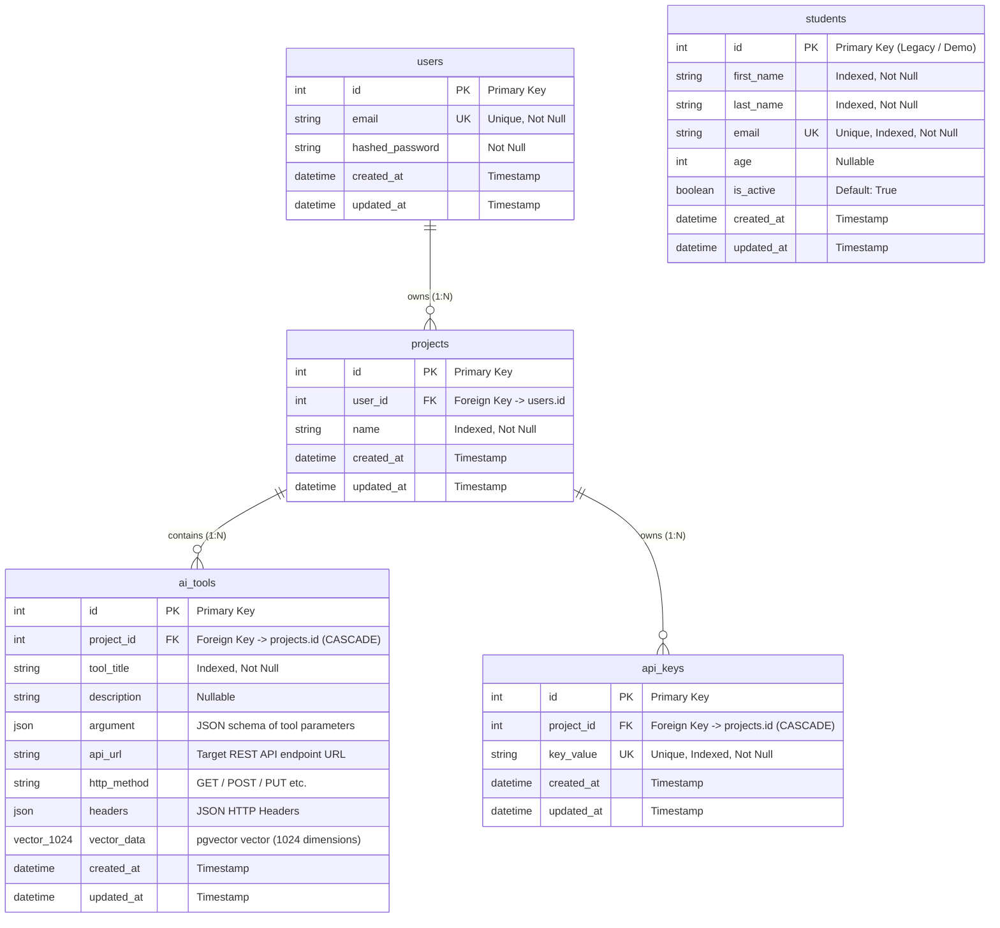
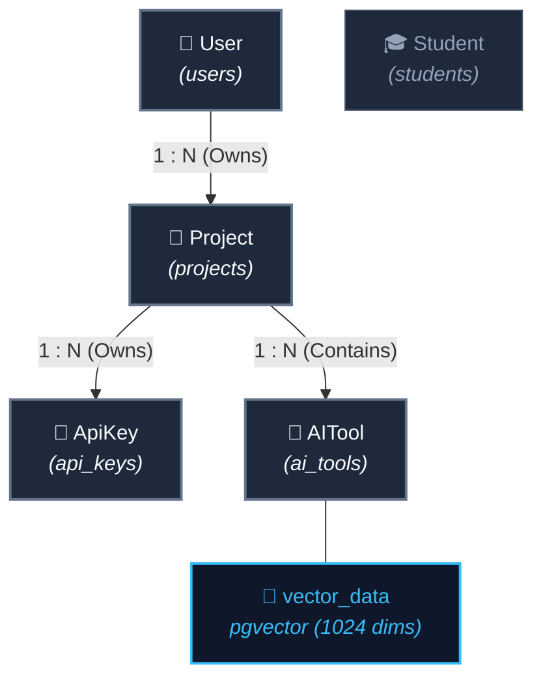

# Database Structure & Entity Relationships

This document details the database architecture, schema models, table columns, constraints, and entity relationships defined in [`app/db/models.py`](file:///d:/personal%20project/reserch2/app/db/models.py).

---

## 1. Visual Entity-Relationship (ER) Diagram

---

## 2. Architecture Flowchart Graph

---

## 3. Table Schemas & Specifications

### 👤 Table: `users`
Stores system user accounts.

| Column | Type | Constraints / Key | Description |
| :--- | :--- | :--- | :--- |
| `id` | `INTEGER` | Primary Key, Indexed | Unique identifier for user |
| `email` | `VARCHAR` | Unique, Indexed, Not Null | Account email address |
| `hashed_password` | `VARCHAR` | Not Null | Hashed account password |
| `created_at` | `TIMESTAMP` | Server Default `NOW()` | Account creation timestamp |
| `updated_at` | `TIMESTAMP` | On Update `NOW()` | Last record modification timestamp |

---

### 📁 Table: `projects`
Workspaces created by users to group resources, API keys, and tools.

| Column | Type | Constraints / Key | Description |
| :--- | :--- | :--- | :--- |
| `id` | `INTEGER` | Primary Key, Indexed | Unique identifier for project |
| `user_id` | `INTEGER` | Foreign Key (`users.id`), Not Null | Owner of this project |
| `name` | `VARCHAR` | Indexed, Not Null | Display name of the project |
| `created_at` | `TIMESTAMP` | Server Default `NOW()` | Project creation timestamp |
| `updated_at` | `TIMESTAMP` | On Update `NOW()` | Last record modification timestamp |

---

### 🔑 Table: `api_keys`
API authentication keys scoped directly to a single project (**One-to-Many**).

| Column | Type | Constraints / Key | Description |
| :--- | :--- | :--- | :--- |
| `id` | `INTEGER` | Primary Key, Indexed | Unique identifier for API key |
| `project_id` | `INTEGER` | Foreign Key (`projects.id` CASCADE), Not Null | Associated Project ID |
| `key_value` | `VARCHAR` | Unique, Indexed, Not Null | Secret key string (e.g. `sk-dummy-...`) |
| `created_at` | `TIMESTAMP` | Server Default `NOW()` | Key generation timestamp |
| `updated_at` | `TIMESTAMP` | On Update `NOW()` | Last record modification timestamp |

---

### 🤖 Table: `ai_tools`
Stores REST API tools discovered or registered for autonomous agent execution.

| Column | Type | Constraints / Key | Description |
| :--- | :--- | :--- | :--- |
| `id` | `INTEGER` | Primary Key, Indexed | Unique tool identifier |
| `project_id` | `INTEGER` | Foreign Key (`projects.id` CASCADE), Not Null | Project owning this tool |
| `tool_title` | `VARCHAR` | Indexed, Not Null | Short identifier / name of the tool |
| `description` | `VARCHAR` | Nullable | Functional description of tool capabilities |
| `argument` | `JSON` | Nullable | Parameter definitions (types, descriptions, locations) |
| `api_url` | `VARCHAR` | Nullable | Target REST endpoint URL |
| `http_method` | `VARCHAR` | Nullable | HTTP verb (`GET`, `POST`, `PUT`, etc.) |
| `headers` | `JSON` | Nullable | Required HTTP headers dictionary |
| `vector_data` | `Vector(1024)` | PostgreSQL `pgvector` | Embedding vector for semantic similarity search |
| `created_at` | `TIMESTAMP` | Server Default `NOW()` | Tool registration timestamp |
| `updated_at` | `TIMESTAMP` | On Update `NOW()` | Last record modification timestamp |

---

### 🎓 Table: `students` *(Standalone / Legacy)*
Demo table for initial CRUD endpoints.

| Column | Type | Constraints / Key | Description |
| :--- | :--- | :--- | :--- |
| `id` | `INTEGER` | Primary Key, Indexed | Unique student identifier |
| `first_name` | `VARCHAR` | Indexed, Not Null | First name |
| `last_name` | `VARCHAR` | Indexed, Not Null | Last name |
| `email` | `VARCHAR` | Unique, Indexed, Not Null | Email address |
| `age` | `INTEGER` | Nullable | Student age |
| `is_active` | `BOOLEAN` | Default `True` | Active status flag |
| `created_at` | `TIMESTAMP` | Server Default `NOW()` | Record creation timestamp |
| `updated_at` | `TIMESTAMP` | On Update `NOW()` | Last record modification timestamp |

---

## 4. Entity Relationships Summary

1. **User ➔ Projects (`1 : N`)**
   - A single `User` can own zero, one, or multiple `Projects`.
   - `User.projects` cascade-deletes all associated projects if the user is deleted (`cascade="all, delete-orphan"`).

2. **Project ➔ ApiKeys (`1 : N`)**
   - A single `Project` can have one or multiple `ApiKey`s.
   - Each `ApiKey` belongs strictly to **one** `Project`.
   - If a project is deleted, its keys are cascade-deleted (`cascade="all, delete-orphan"`).

3. **Project ➔ AI Tools (`1 : N`)**
   - A single `Project` can contain multiple `AITools`.
   - `Project.ai_tools` cascade-deletes all associated tools if the project is deleted (`cascade="all, delete-orphan"`).
